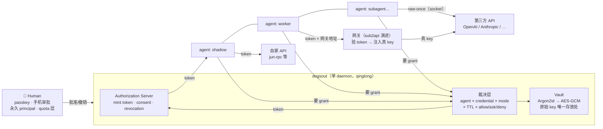

# 一句话定位

**单用户、自托管的 authorization server：一个用户带着一打 agent，dogsout 是这打 agent 的唯一身份与授权入口。**

前身是两个项目合并：

- **junethekey（jtk）** — agent 凭据经纪人：策略矩阵、加密 vault、手机审批（repo 已 rename 为 dogsout，git 历史保留）
- **dogsout-auth**（原 june-oauth，2026-10-24 更名）— 手写的 OAuth 2.0 / OIDC provider：PKCE、refresh rotation、JWKS 协议核心，独立专业 OAuth 服务器演进

---

## 1. 要解决的问题（我们自己的 fleet 就是第一个用户）

现状事实：3 台机器（Mac / Mistplay 机 / qinglong）、pi 的 5 个 persona（shadow/worker/expert/finder/prospector）+ subagent，全部依赖——

- **共享 API key** 存 1Password，经 opk 注入进程
- **per-profile guard 文件**（`_guard.sh`）做粗粒度边界

这意味着：泄漏一个 key = 全线失守；没有任何记录能回答「**这个 API 调用是哪个 agent 发的**」；撤销一个 agent = 换所有 key。

## 2. 核心模型：人是唯一主体

| 角色 | 属性 | 规则 |
|---|---|---|
| **Human** | 永久 principal，passkey/WebAuthn 认证 | **从不 ban 人**；quota 挂在 human 层，滥用→限流，付费→提额 |
| **Agent** | 可抛弃的 OAuth client（自己的 keypair，DPoP 绑定） | 随时 revoke 整个 family，从不心疼；用量**聚合到 human** 计量 |

- Token 形状：`sub = user, act = agent` —— 人是 authority，agent 是执行者（IETF 里 Anthropic/OpenAI 正在争的语义，我们选这一边，审计才立得住）
- Delegation：`user → foreman → shadow → subagent` 每跳 Token Exchange（RFC 8693），**权限单调收窄、不能放大**，链上进 claims

## 3. 授权面：一次授权，三种交付

Agent 的每个请求走同一个裁决矩阵：`agent × credential × delivery_mode × TTL × decision(allow/ask/deny)`，批准记录进 grants（只存 value_hash，不可反推）。

| delivery mode | agent 拿到什么 | key 泄漏面 | 适用 |
|---|---|---|---|
| **token** | dogsout mint 的短命 JWT（scoped + aud） | 零 | 自家 API（jun-rpc、后续所有 agent 服务） |
| **proxy** | 入口地址 + token，网关注入真 key | 一台网关 | 支持 HTTP 代理的第三方（LLM API 全走这条） |
| **raw-once** | key 本体，one-shot 进内存 | 调用进程存活期 | 只认 raw key 且无法代理的老 API |

**选型顺序：能 token 不 proxy，能 proxy 不 raw。**

## 4. Scope 的真相

Scope 是 **token 里的 claim**，只在「签发方是自己」的世界里真实存在：

- **token 模式** — 原生生效：claims 写什么就只有什么，RS 验 `scope` + `aud`，越界拒绝
- **proxy 模式** — 网关执行：验 token 的 scope + 配额；注入的是 vault 里**预存的低权限变体**（如 scope `llm:cheap` → 只许网关用 spend-limit 低的那把 key）。「scoped key」的本质是「vault 存了最小权限版本，scope 决定挑哪把」
- **raw 模式** — 上游不认 scope，无解；只能 vault 存 fine-grained 版本（GitHub fine-grained PAT / OpenAI project key / AWS scoped IAM）+ TTL

## 5. Key 传递的物理极限

**如果上游只认 raw key，任何能工作的方案都必须让 key 在调用瞬间出现在调用进程内存里** —— 信息论下限，Vault 也好 dogsout 也好谁都绕不开。能控制的只有四个变量：

- **在哪存** — 静止态只在加密 vault（Argon2id master → AES-256-GCM），agent 侧零副本
- **活多久** — TTL=once；能 rotate 的上游用后即 rotate
- **怎么传** — 本地 unix socket 直达进程内存，**不走 env var、不走文件**（env 会被 `ps e`/子进程继承/core dump 泄漏）
- **留什么痕** — grants 只存 value_hash + agent + 时刻 + 批准通道

## 6. 架构

## 7. 协议对齐（底座已定，不用发明）

标准世界的收敛方向（2026-10 可查证）：

- **OAuth 2.1** — dogsout-auth（原 june-oauth）已实现的形状（强制 S256 PKCE、exact redirect_uri、one-time code、refresh rotation + reuse detection、RS256 JWKS + discovery）基本就是它要求的
- **RFC 8693 Token Exchange** — delegation 原语，`act` claim 记录委托链
- **DPoP（RFC 9449）** — sender-constrained token，token 被偷也重放不了
- **MCP 2026-07-28** — agentic auth 定为 OAuth 2.1 + RFC 8707 resource binding + CIMD 注册
- **A2A 1.0**（Linux Foundation）— agent 相互发现与认证
- 还在 draft 的：多跳 delegation 语义、agent registry —— 上层在乱战， dogsout 不依赖它们

## 8. 资产合并现状

- ✅ repo rename 已做：`junethekey` → **`dogsout`**（GitHub 重定向生效，本地路径与 remote 已更新）
- ⚠️ 工作树里有 the in-flight mygo approval-UI work（swiftui→mygo、ask.go 等）——先收尾再开 rewrite
- 📦 ~~dogsout-auth 的 `lib/*.ts`（约 400 行协议核心）待移植到 `apps/api`（Hono + drizzle）~~ **作废（2026-10-24）**：dogsout-auth 定位为独立的专业 OAuth 服务器，两个 repo 并行演进，不再移植合并
- 📦 jtk 已有：P0 策略引擎（118 测试绿）、vault、审批通道（mygo UI + 手机 SSH）
- 📦 sub2api 就是现成的 proxy 网关，缺的只是「token 换成带 agent 身份的短期凭证」

## 9. 里程碑

| 阶段 | 内容 | 验收 |
|---|---|---|
| **M1** | SQLite 持久化 + argon2id + signing key 落盘 | ✅ 完成（2026-10-23，june-oauth 内实施）：e2e 全绿、JWKS/session 重启存活、argon2id 登录验证 |
| **M2** | agent registry + human passkey 登录 + consent | ✅ 完成（2026-10-23，june-oauth 内实施）：passkey 注册/无用户名登录（虚拟认证器 e2e 全过）、/admin agent 注册表（secret 只显示一次）、agent 撤销级联 |
| **M3** | client_credentials + device_code + introspection | 新机器上一条命令接入 |
| **M4** | 三种 delivery mode 裁决落地 + sub2api 对接 | agent 调 LLM 全程不接触真 key |
| **M5** | delegation chain（act）+ quota claims | 「哪个 agent 在烧钱」永远可回答 |

## 10. 决议记录

**已定：**

- 人是唯一主体；从不 ban 人，quota 管滥用，付费提额
- 单用户，不上 Cloudflare；部署 qinglong
- jtk 并入 dogsout（vault 做后端，不再独立repo）
- 授权 = 三种 delivery mode 统一裁决
- repo rename：junethekey → dogsout（已完成）
- june-oauth → **dogsout-auth**（2026-10-24）：定位 = 独立的专业 OAuth 服务器（dedicated professional OAuth server），与 dogsout 双 repo 并行演进；原「协议核心移植进 apps/api」计划作废
- **指纹解锁取消（2026-10-30，junguo 拍板）**：本地方案改为 `unlock-token`（0600）驱动的 token slot，`dogsout init` 默认不再要 Touch ID；SE slot 降为 legacy opt-in（`--se` / `DOGSOUT_ALLOW_SE=1`，迁移命令 `vault token add` 一次性使用）。终态：token 由 dogsout-auth 签发、自动续约，reference 的有效期跟随 token 有效期，reference 尽量上云并与 auth 绑定

**待拍板：**

- ~~CLI 二进制名~~ → 已定（2026-10-23）：一律 `dogsout`，包括 CLI
- the mygo approval UI → decided（2026-10-23）：合并收尾，归入 rewrite 阶段，不单独阻塞
- quota 计量点：AS 签发侧计量，还是 RS（网关）调用侧计量，还是两边各记一半
- 执行顺序（2026-10-23 拍板）：分阶段、不急；当前阶段 = **M1**
